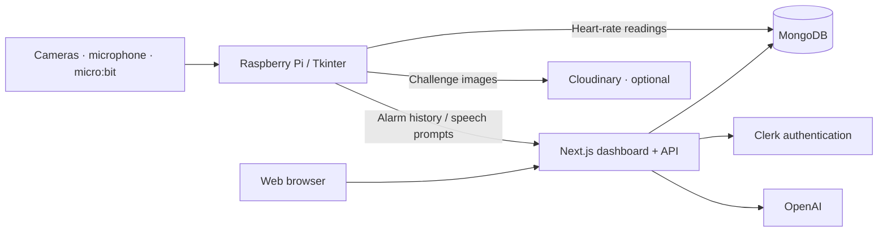

<p align="center">
  
</p>

# RiseWell

A smart alarm clock prototype that combines wake-up challenges, Raspberry Pi sensors, and a web dashboard for sleep and alarm analytics.

Built as an **IS4151 group project**, RiseWell explores a problem that a time-based alarm alone does not solve: getting out of bed and staying awake. The Pi runs interactive challenges, records alarm sessions, and uses camera-based pose classification to check whether a user has returned to bed. A companion dashboard shows alarm history and heart-rate readings, with AI-generated summaries.

This is an educational hardware/software prototype. Sleep classification and heart-rate summaries are experimental, not clinically validated. Caregiver alerts, subscriptions, and institutional monitoring discussed in the original project proposal are product ideas, not guarantees of implemented features. There is no maintained hosted demo; run your own instance using the instructions below.

## What’s here

- **Wake-up challenges:** math, speech recitation, micro:bit shaking, image recognition, and reference-image matching.
- **Raspberry Pi interface:** a Tkinter touchscreen UI for configuring and completing alarms.
- **Sensor integration:** serial heart-rate readings, Bluetooth micro:bit interaction, cameras, microphone, and speaker.
- **Web dashboard:** Clerk sign-in, alarm history, sleep/heart-rate charts, and OpenAI-generated reports and speech prompts.
- **Sleep detection experiments:** pose extraction and classifier training notebooks, plus exported model/scaler files used by the Pi.



| Directory | Purpose |
| --- | --- |
| `webapp/` | Next.js App Router frontend and API routes; TypeScript, Tailwind CSS, shadcn/ui, Recharts |
| `iot-alarm-clock/` | Raspberry Pi application, sensor integrations, alarm challenges, inference models |
| `AI_sleep_detection/` | Training notebooks, processed landmark data, and camera experiments |
| `docker-compose.yml` | Optional local RabbitMQ experiment; does not run the web app or MongoDB |

## Run the web app locally

You need Node.js 22 LTS with npm, a running MongoDB instance (local or Atlas), a Clerk application, and an OpenAI API key for AI features. Create your own service accounts; no shared demo account is provided.

```bash
git clone https://github.com/glennquah/rise-well.git
cd rise-well/webapp
cp .env.example .env.local
npm ci
```

Fill in `webapp/.env.local`:

| Variable | Purpose |
| --- | --- |
| `MONGODB_URI` | Connection string for your database; application code uses database `rise-well` |
| `NEXT_PUBLIC_CLERK_PUBLISHABLE_KEY` | Public key from your Clerk application |
| `CLERK_SECRET_KEY` | Server-side Clerk secret for the same application |
| `OPENAI_API_KEY` | Server-side key for speech prompts and generated reports; usage may incur costs |

Configure Clerk for your local origin, then start the app:

```bash
npm run dev
```

Open <http://localhost:3000> and sign in. Analytics require records associated with your own Clerk user ID. MongoDB Compass is an optional database viewer, not a database server. Never commit real `.env` files or use real health data for a demo.

## Run the Raspberry Pi application

The full application requires Raspberry Pi OS with a desktop/display, Python 3 and Tkinter, audio input/output, cameras, and micro:bit hardware. Hardware-dependent libraries in `requirements.txt` may require OS packages and a compatible Pi/Python version; this is a snapshot of the original prototype environment, not a portable desktop installer.

```bash
cd iot-alarm-clock
python3 -m venv .venv
source .venv/bin/activate
pip install -r requirements.txt
cp .env.example .env
```

Set `RISEWELL_API_URL` to your web app’s origin, `RISEWELL_USER_ID` to your Clerk user ID, and `MONGO_URI` to the same database used by the web app. The application loads this `.env` at startup. When the app runs on another computer, use its LAN address: `localhost` on the Pi refers to the Pi itself.

Before starting:

1. Connect the micro:bit with compatible serial/BLE firmware. The repository does not include a complete firmware flashing guide.
2. Check `/dev/ttyACM0` in `sensors/serial_heartrate_reader.py` and `gui/count_down_window.py`; both currently access the serial device and may contend for the same port.
3. Set your micro:bit Bluetooth address in `alarm/shake_it_alarm.py` and pair the speaker using the OS Bluetooth settings.
4. Check camera index `2` in the image challenge/configuration and sleep detection modules. Confirm the microphone and speaker work in Raspberry Pi OS.
5. For image uploads, configure your own `CLOUDINARY_CLOUD_NAME` and `CLOUDINARY_UPLOAD_PRESET`. An unsigned preset should have restrictive upload limits.

Run from the `iot-alarm-clock` directory so relative asset paths resolve:

```bash
python main.py
```

Grant the current user access to the required serial/Bluetooth devices rather than running the whole application as root. The GUI’s user ID must match the configured heart-rate user ID for consistent analytics. Speech transcription uses an external recognition service, and some image models may download weights on first use.

## Deploy your own instance

Deploying is optional: local development is enough to explore the code. The web app can run on a Next.js host; the Tkinter application stays on the Pi. **Use an access-restricted demo environment until the API issues in [SECURITY.md](SECURITY.md) are resolved.** Clerk sign-in alone does not protect every route in this prototype.

### Web app on Vercel

1. Import your fork into Vercel and select **`webapp` as the Root Directory**, with the Next.js framework preset.
2. Use `npm ci` to install and `npm run build` to build; retain the framework’s default output settings.
3. Add all four web environment variables listed above to the appropriate Vercel environments. Use a MongoDB host reachable from Vercel, with a dedicated database user and suitable network access rules. A local database on your laptop will not be reachable by default.
4. Configure the new domain in your Clerk application and use matching production keys for a production deployment. Redeploy after changing build-time public keys.
5. Set the Pi’s `RISEWELL_API_URL` to the new HTTPS origin and restart the Pi app. The Pi’s separate `MONGO_URI` must also point to your database.
6. Verify sign-in, an alarm-history round trip, matching user IDs, and AI features with synthetic data. Hosting access restrictions must also allow your Pi client; this repository does not implement a hosting-protection bypass flow.

See [Vercel’s Next.js deployment documentation](https://vercel.com/docs/frameworks/full-stack/nextjs).

### Self-host the web app

From `webapp/`, with the environment variables configured:

```bash
npm ci
npm run build
npm run start
```

This starts the Next.js server on port 3000. For a remote instance, configure HTTPS, a process supervisor, and a reverse proxy. The API routes require a server runtime; a static HTML export is insufficient. See the [Next.js self-hosting guide](https://nextjs.org/docs/app/guides/self-hosting).

## Development and limitations

After starting Next.js once to generate `next-env.d.ts`, run `npx tsc --noEmit` and `npm run lint` in `webapp/` before submitting changes. For a production build, also run `npm run build` with your service configuration available. Hardware workflows must be checked on the Pi; there is no automated hardware test suite.

The optional RabbitMQ service can be started with `docker compose up -d`. It is unrelated to the main setup above and uses development credentials; keep it on a trusted local machine.

The training notebooks and bundled model files preserve the original experiment. Dataset provenance and model redistribution rights need review before redistributing derived data/models. Only load serialized models from a trusted source.

## Contributing and credits

Small fixes, clearer setup notes, and reproducible hardware instructions are welcome. Open an issue with the environment, steps to reproduce, and expected behavior, or a focused pull request. Keep credentials, personal records, and captured images out of contributions. Report security issues privately; see [SECURITY.md](SECURITY.md).

Created by Glenn Quah, Emily Tan, Ophelia Teo, Jordan Wong, and Hamza Zarfaoui for IS4151.

## License

Source code is available under the [MIT License](LICENSE). Third-party dependencies retain their own licenses. The license does not establish redistribution rights for third-party training data, model inputs, or assets; review their provenance before reuse.
